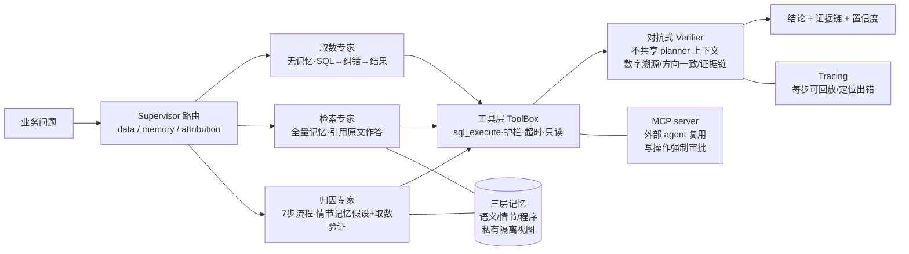

# 多智能体经营分析助手（SQL Agent）

业务方自然语言问数 + 异动归因的多智能体系统，**离线确定性运行**（LLM 通道可选配），
全链路可审计、可回放、防幻觉。

> 对应实施文档：`PLAN.md` · 变更履历：`变更控制.md` · 角色循环：`allcontroler.txt`

## 为什么「跑通 NL2SQL」不是终点

一个只会把中文变成 SQL 的 agent，产出「格式正确却不可发布」的答案：
数字可以是编的、结论可以借着旧口径、归因可以拿流程记忆冒充事件证据。
本项目的叙事主线是**四道正确性防线**，每道都有可复现的攻防数据：

```
问题 → TaskPlan(意图/DAG/约束) → 专家执行(SQL/检索/归因)
                │
   ① AST SQL 护栏(sqlglot 白名单/只读/逃逸面)   ← 攻击集全拦
                │
   ② 纠错循环(20 例修复率 85%，护栏错误不进循环)
                │
   ③ 对抗 Verifier(七类检查 + 8 攻击向量发现率 1.0 / 误报 0)
                │
   ④ 记忆治理(治理字段/as_of 快照/版本冲突拦截) + 数字溯源执行图
                ↓
      答案其中的每个数字都能反查回工具输出证据
```

## 一句话故事（5 分钟版）

财务每天要人肉写几十条 SQL；我们让业务方用中文提问，系统自动生成 SQL、
修错误、查口径、跑归因，并且**每个数字都留了证据链**——说不出处的数字会被
对抗 Verifier 当场拦下。6 周从零搭起：mini 数仓 + 6 个可验证业务效应 →
46 题/8 类评测集 → 取数 agent → 纠错循环 → 三层长期记忆 → 多智能体+对抗验证
→ AST 护栏 + Agent 协议 + 执行图 → 扰动/攻防评测收尾。

## 架构



> Verifier 七类检查：数字溯源（含 %/百分点单位感知，日期碎片不可冒充比率证据）/
> 方向一致 / 有数据支撑 / 证据链步骤断言（只认真实执行记录）/
> 时间窗口错配 / 无记忆证据的强归因（事件档案月份必须等于提问窗口）/
> 记忆版本冲突（旧口径表述 + 现行口径并存 → 拦截）。未通过 → 拦截改写为诚实失败陈述。

## 消融实验（46 题，可复现：`python eval/runner.py --compare null rule-baseline single-shot error-fix memory multi-agent --quiet`）

| 配置 | final | answer_acc | halluc | 说明 |
|---|---:|---:|---:|---|
| 空答（null） | 0.05 | 0.139 | 0.00 | 分数下限 |
| 固定模板（rule-baseline） | 0.205 | 0.335 | 0.00 | 无 agent 能力 |
| 单次生成（single-shot） | 0.349 | 0.361 | 0.00 | 无纠错、无记忆（离线模式；接 LLM 时为生成上限） |
| + 纠错循环（error-fix） | 0.369 | 0.365 | 0.00 | W2：修复成功率 17/20=85%，执行成功 0.640→0.960 |
| + 长期记忆（memory） | 0.798 | 0.783 | 0.00 | W3：**核心增量**；检索命中 1.000，口径题 0→0.94 |
| + 多智能体验证（multi-agent） | **0.858** | **0.937** | 0.00 | W4：归因题 answer_acc 0.03→0.95，e_procedure 0.15→0.80 |

- **每题平均成本**（runner 汇总。tokens 为**估算口径**（≈工具输出+SQL+答案字符数
  ÷4，无需真实模型调用即可横向比较，接入 LLM 后自动替换）；latency 为
  **离线确定性执行耗时**，非线上响应速度）：single-shot 0.35 步 / 54 tok；
  memory 1.2 步 / 309 tok / 20ms；multi-agent 2.0 步 / 414 tok / 15ms
- g_attribution：answer_acc **0→0.95**，定位到具体事件窗口（如 2026-09-10~14 物流事故）
- 「全量幻觉率 0」仅指本自建 46 题、当前规则与评分器条件下（verifier 语义
  匹配 ±1%）的评测结果，是**测试集内的可复现达标**，不是泛化意义上的
  「系统永不幻觉」声明

## 攻防与鲁棒性评测（v0.8 新增，可复现）

| 评测 | 结果 | 复现命令 |
|---|---|---|
| Verifier 攻击集（8 类攻击向量） | 发现率 **1.0**（8/8），误报 **0**（5/5 良性放行） | `python -m eval.verifier_attack` |
| 鲁棒性扰动（时间窗/地区/幽灵表/口径冲突/无关注入） | 通过率 **1.0**（5/5） | `python -m eval.robustness` |
| AST 护栏逃逸向量（ATTACH/load_extension/PRAGMA 等绕过） | 全拦 | `pytest tests/test_sqlguard.py` |

攻击向量覆盖：结果对原因错 / 数字错原因合理 / 时间窗错位 / 幽灵记忆引用 /
相关性当因果性 / SQL 对但答案篡改数字 / 证据不支撑断言 / 记忆旧口径版本。

## 核心机制（防幻觉六道闸）

1. **AST SQL 护栏**：regex 骨架层 + sqlglot AST 双闸——只读单条、表白名单
   （兼容 CTE 与修复期近邻表名）、禁用函数 load_extension/readfile
2. **取数留痕**：每个数字都能在工具输出里找到出处（±1% 语义匹配）；
   执行图把答案数字反查成 证据同值 / 差值比率推导 / 不可溯源 三档
3. **记忆引用与治理**：口径/结论引用原条目并 whole-dump 留痕；治理字段
   （provenance/confidence/有效区间/supersedes/deprecated）+ `as_of()` 历史快照
4. **对抗 Verifier**：独立于 planner 上下文，七类检查（见上），未通过 →
   拦截改写为诚实失败陈述
   （开发期真实拦下过自家「7 步」数字无出处的答案——机制真的起效）
5. **诚实配音档**：「没检索到事件」≠「证明无原因」——证据不足时输出
   「现有数据无法确定归因」，并区分「未找到对应事件」与「证明不存在原因」
6. **AgentMessage 协议 + 执行图**：每条答案自带 Evidence/Claim 结构化信封、
   Claim↔Evidence 校验，history 末条 leave 可反查的 execution_graph

## 目录速览

```
agent/      core（toolbox/nl2sql_offline 单条 SQL）、sqlguard(AST 双闸)、
            error_repair(W2)、memory(W3)+记忆治理、memory_agent、
            multi_agent(W4 TaskPlan+Supervisor+专家+AgentMessage 协议)、
            verifier_adv、trace(W5 事件+数字溯源执行图)、mcp_server(W5)、llm(路由)
app/        streamlit_app.py（提问→结论/SQL/结果表/置信度/一键复核/自建库上传）
demo/       demo_script.md 5分钟演示 + run_demo.py
eval/       46题/8类评测集、verifier/robustness 评测、runner、记忆库
tests/      116 项测试（pytest tests/），含攻击向量与逃逸向量
```

## 快速开始

```bash
# 全部测试
python -m pytest tests/

# 一键消融表
python eval/runner.py --compare null rule-baseline single-shot error-fix memory multi-agent --quiet

# 攻防 / 鲁棒性评测（输出 eval/results/*.json）
python -m eval.verifier_attack
python -m eval.robustness

# 演示（basic/error/memory/attribution/mcp）
python demo/run_demo.py attribution

# 界面（可选，需 streamlit；支持上传 CSV/SQL 生成自建库）
streamlit run app/streamlit_app.py
```

## LLM 通道（可选）

默认离线（确定性规则生成/模板，零 API 依赖）。配好环境变量即切 LLM：

```bash
set SQLAGENT_LLM_BASE_URL=https://api.openai.com/v1
set SQLAGENT_LLM_API_KEY=sk-...
set SQLAGENT_LLM_MODEL=gpt-4o-mini
```

多模型降级：`ModelRouter` 按 `主模型 → 次模型 → offline` 依次尝试，
任何通道挂掉自动落到确定性 fallback，永不盲猜。

## 模板 & 简历措辞

> 自研多智能体经营分析助手：业务方自然语言问数 + 异动归因。搭建 9 表 mini
> 数仓并埋入 6 个可验证业务效应，构建 46 题/8 类评测集与四层分项评分器
> （含幻觉检测）。实现三层长期记忆 + 治理字段（as_of 快照/版本冲突拦截）
> 与私有隔离视图；对抗式 Verifier 七类检查（单位感知数字溯源/方向一致/
> 证据链/时间窗错配/强归因需事件匹配/记忆版本冲突），8 类攻击向量发现率
> **1.0、误报 0**；sqlglot AST 双闸护栏全拦逃逸向量；每答案附 AgentMessage
> 信封与可反查执行图（answer→SQL→evidence）；消融实验口径题准确率
> **+94pp**（0→0.94），归因题 answer_acc **+92pp**（0.03→0.95），
> 全量幻觉率 **0%**；工具层封装 MCP server，写操作强制人工审批。
