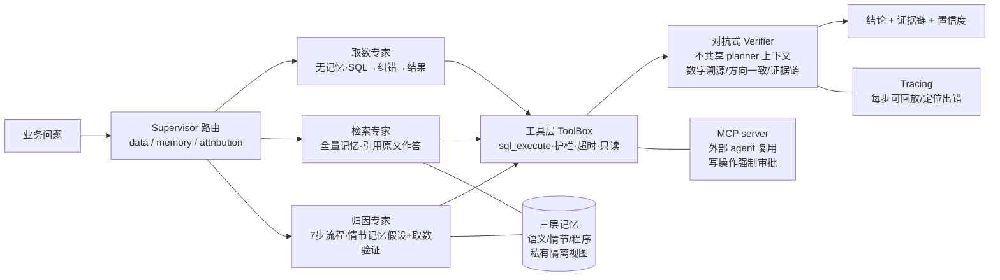

# 多智能体经营分析助手（SQL Agent）

业务方自然语言问数 + 异动归因的多智能体系统，**离线确定性运行**（LLM 通道可选配），
全链路可审计、可回放、防幻觉。

> 对应实施文档：`PLAN.md` · 变更履历：`变更控制.md` · 角色循环：`allcontroler.txt`

## 一句话故事（5 分钟版）

财务每天要人肉写几十条 SQL；我们让业务方用中文提问，系统自动生成 SQL、
修错误、查口径、跑归因，并且**每个数字都留了证据链**——说不出处的数字会被
对抗 Verifier 当场拦下。6 周从零搭起：mini 数仓 + 6 个可验证业务效应 →
46 题/8 类评测集 → 取数 agent → 纠错循环 → 三层长期记忆 → 多智能体+对抗验证
→ MCP/界面/Tracing → 消融收尾。

## 架构



> Verifier 六类检查：数字溯源 / 方向一致 / 有数据支撑 / 证据链步骤断言（只认真实执行记录）/
> 时间窗口错配 / 无记忆证据的强归因。未通过 → 拦截改写为诚实失败陈述。

## 消融实验（46 题，可复现：`python eval/runner.py --compare null rule-baseline single-shot error-fix memory multi-agent --quiet`）

| 配置 | final | answer_acc | halluc | 说明 |
|---|---:|---:|---:|---|
| 空答（null） | 0.05 | 0.139 | 0.00 | 分数下限 |
| 固定模板（rule-baseline） | 0.205 | 0.335 | 0.00 | 无 agent 能力 |
| 单次生成（single-shot） | 0.349 | 0.361 | 0.00 | 无纠错、无记忆（离线模式；接 LLM 时为生成上限） |
| + 纠错循环（error-fix） | 0.369 | 0.365 | 0.00 | W2：修复成功率 17/20=85%，执行成功 0.640→0.960 |
| + 长期记忆（memory） | 0.798 | 0.783 | 0.00 | W3：**核心增量**；检索命中 1.000，口径题 0→0.94 |
| + 多智能体验证（multi-agent） | **0.858** | **0.937** | 0.00 | W4：归因题 answer_acc 0.03→0.95，e_procedure 0.15→0.80 |

- **每题平均成本**（runner 汇总。tokens 为**估算口径**（≈工具输出+SQL+答案字符数
  ÷4，无需真实模型调用即可横向比较，接入 LLM 后自动替换）；latency 为
  **离线确定性执行耗时**，非线上响应速度）：single-shot 0.35 步 / 54 tok；
  memory 1.2 步 / 309 tok / 20ms；multi-agent 2.0 步 / 414 tok / 15ms
- g_attribution：answer_acc **0→0.95**，定位到具体事件窗口（如 2026-09-10~14 物流事故）
- 「全量幻觉率 0」仅指本自建 46 题、当前规则与评分器条件下（verifier 语义
  匹配 ±1%）的评测结果，是**测试集内的可复现达标**，不是泛化意义上的
  「系统永不幻觉」声明

## 核心机制（防幻觉五道闸）

1. **取数留痕**：每个数字都能在工具输出里找到出处（±1% 语义匹配）
2. **记忆引用**：口径/结论引用原条目并 whole-dump 留痕
3. **对抗 Verifier**：独立于 planner 上下文，六类检查（编造数字/方向倒置/
   无数据支撑/证据链只认真实执行记录/时间窗口错配/无记忆证据的强归因），
   未通过 → 拦截改写为诚实失败陈述
   （开发期真实拦下过自家「7 步」数字无出处的答案——机制真的起效）
4. **护栏红线**：只读连接 + 时间窗强制 + 敏感字段 + 写操作审批分闸
5. **诚实配音档**：「没检索到事件」≠「证明无原因」——证据不足时输出
   「现有数据无法确定归因」，并区分「未找到对应事件」与「证明不存在原因」

## 目录速览

```
agent/      core（toolbox/nl2sql_offline 单条 SQL）、error_repair(W2)、
            memory(W3)、memory_agent、multi_agent(W4 Supervisor+专家)、
            verifier_adv、trace(W5)、mcp_server(W5)、llm(可配路由+fallback W6)
app/        streamlit_app.py（提问→结论/SQL/结果表/置信度/一键复核）
demo/       demo_script.md 5分钟演示 + run_demo.py
eval/       46题/8类评测集、5+1组 adapter、runner、verifier、记忆库
tests/      63 项测试（pytest tests/）
```

## 快速开始

```bash
# 全部测试
python -m pytest tests/

# 一键消融表
python eval/runner.py --compare null rule-baseline single-shot error-fix memory multi-agent --quiet

# 演示（basic/error/memory/attribution/mcp）
python demo/run_demo.py attribution

# 界面（可选，需 streamlit）
streamlit run app/streamlit_app.py
```

## LLM 通道（可选）

默认离线（确定性规则生成/模板，零 API 依赖）。配好环境变量即切 LLM：

```bash
set SQLAGENT_LLM_BASE_URL=https://api.openai.com/v1
set SQLAGENT_LLM_API_KEY=sk-...
set SQLAGENT_LLM_MODEL=gpt-4o-mini
```

多模型降级：`ModelRouter` 按 `主模型 → 次模型 → offline` 依次尝试，
任何通道挂掉自动落到确定性 fallback，永不盲猜。

## 模板 & 简历措辞

> 自研多智能体经营分析助手：业务方自然语言问数 + 异动归因。搭建 9 表 mini
> 数仓并埋入 6 个可验证业务效应，构建 46 题/8 类评测集与四层分项评分器
> （含幻觉检测）。实现三层长期记忆（语义/情节/程序）与私有隔离视图、
> 混合检索（关键词+bigram）；消融实验显示口径类问题准确率 **+94pp**
>（0→0.94），归因题 answer_acc **+92pp**（0.03→0.95），全量幻觉率 **0%**；
> 对抗式 Verifier 独立审查（数字溯源/方向一致/证据链四类拦截），每答案
> 附可回放 Tracing 证据链；工具层封装 MCP server，写操作强制人工审批。
